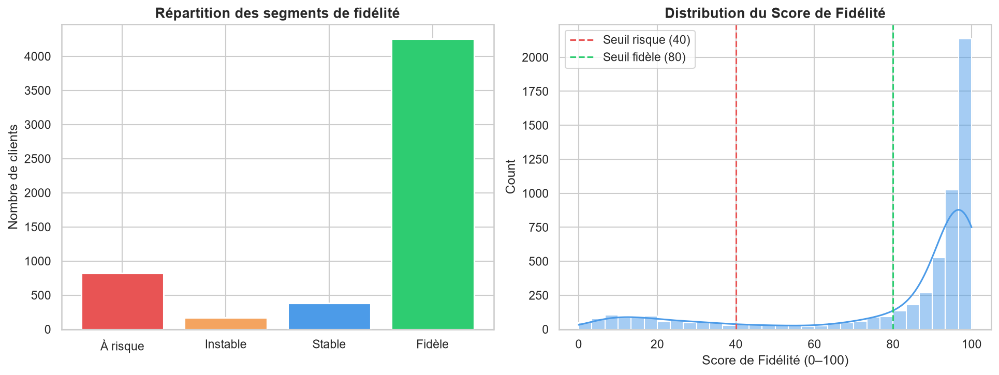
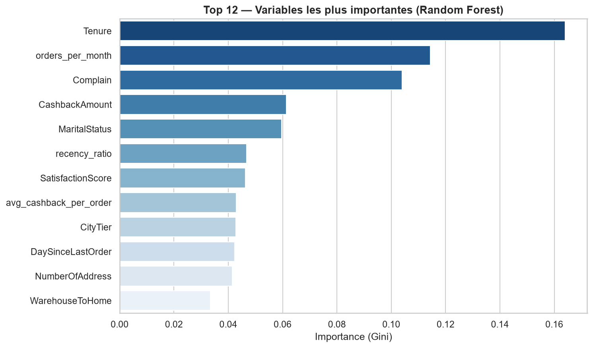
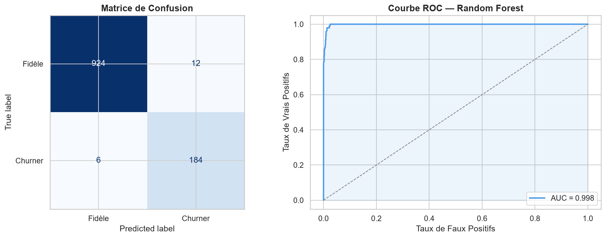

# Scoring de fidélité client — Prédiction du churn e-commerce

Modèle de classification supervisée qui prédit le risque de churn (désabonnement) de chaque client
d'un site e-commerce, et le traduit en **score de fidélité de 0 à 100** segmenté en 4 catégories
directement exploitables par les équipes CRM et marketing.

**Auteurs :** Bakou, Antoine, Jonathan

## Contexte

Dans un e-commerce très concurrentiel, fidéliser un client coûte en moyenne 5 fois moins cher que
d'en acquérir un nouveau. L'objectif est d'identifier les clients à risque **avant** qu'ils ne
partent, pour concentrer les actions de rétention là où elles ont le plus d'impact.

## Résultats clés

| Indicateur | Valeur |
|---|---|
| AUC-ROC — jeu de test (20 %) | **0,998** |
| AUC-ROC — validation croisée (5 folds) | 0,977 |
| AUC-ROC — base complète (out-of-fold) | 0,991 |
| Rappel churners (test) | 97 % |
| Précision churners (test) | 94 % |

Le score de fidélité segmente les 5 630 clients de façon cohérente avec le churn réellement observé :

| Segment | Score | Clients | Taux de churn réel |
|---|---|---|---|
| À risque | 0 – 40 | 824 | 95,0 % |
| Instable | 40 – 60 | 172 | 57,6 % |
| Stable | 60 – 80 | 380 | 12,1 % |
| Fidèle | 80 – 100 | 4 254 | 0,5 % |



### Enseignements métier

- **Le churn est un problème d'onboarding.** L'ancienneté est la variable la plus prédictive :
  les churners ont une ancienneté médiane de 1 mois, contre 10 mois pour les clients fidèles.
- **Les réclamations sont un signal d'alerte fort** (3e variable la plus importante,
  corrélation de +0,25 avec le churn) : leur traitement rapide est un levier de rétention direct.
- **La satisfaction déclarée est un mauvais indicateur** : elle est en moyenne légèrement *plus*
  élevée chez les churners (3,39 contre 3,00).



## Données

[E-Commerce Customer Churn Dataset](https://www.kaggle.com/datasets/ankitverma2010/ecommerce-customer-churn-analysis-and-prediction)
(Kaggle) : 5 630 clients, 18 variables explicatives (ancienneté, commandes, cashback,
réclamations, satisfaction, moyens de paiement…) et une cible binaire `Churn` (16,8 % de churners).

Le fichier `E Commerce Dataset.xlsx` contient deux feuilles : `Data Dict` (dictionnaire des
variables) et `E Comm` (les données).

## Méthodologie

1. **Nettoyage** : harmonisation des modalités redondantes (`Phone` / `Mobile Phone`,
   `CC` / `Credit Card`, `COD` / `Cash on Delivery`…), encodage des variables catégorielles.
2. **Analyse exploratoire** : distribution de la cible, distributions par statut client,
   matrice de corrélation.
3. **Feature engineering** : commandes par mois d'ancienneté, cashback moyen par commande,
   ratio de récence.
4. **Modélisation** : pipeline `imblearn` sans fuite de données :

   ```
   SimpleImputer (médiane) → features dérivées → SMOTE → RandomForestClassifier
   ```

   Toutes les étapes qui apprennent des données (médianes, points synthétiques SMOTE) sont
   ajustées uniquement sur les données d'entraînement de chaque fold. Les hyperparamètres sont
   optimisés par `GridSearchCV` (validation croisée stratifiée 5 folds, métrique AUC-ROC).
5. **Évaluation** sur un jeu de test stratifié de 20 % jamais vu pendant l'entraînement.
6. **Scoring de toute la base** par prédictions *out-of-fold* (`cross_val_predict`) : chaque
   client est scoré par un modèle entraîné sans lui, ce qui évite les scores sur-confiants
   qu'un Random Forest produit sur ses propres données d'entraînement.



## Structure du projet

```
├── projet_scoring_fidelite_client.ipynb   # Notebook exécuté, avec résultats et graphiques
├── projet_scoring_fidelite_client.py      # Même pipeline en script Python
├── E Commerce Dataset.xlsx                # Données brutes (Kaggle)
├── loyalty_scores_output.csv              # Scores de fidélité exportés pour Power BI
├── requirements.txt
└── 1_ … 6_*.png                           # Graphiques générés
```

## Installation et exécution

```bash
pip install -r requirements.txt
```

Ouvrir le notebook dans Jupyter ou VS Code, ou exécuter le script :

```bash
python projet_scoring_fidelite_client.py
```

L'exécution complète (dont le `GridSearchCV` sur 24 combinaisons × 5 folds) prend quelques
minutes. Testé avec Python 3.12, pandas 3.0, scikit-learn 1.9, imbalanced-learn 0.14 et
seaborn 0.13.

## Export Power BI

`loyalty_scores_output.csv` contient une ligne par client :

| Colonne | Description |
|---|---|
| `CustomerID` | Identifiant client |
| `loyalty_score` | Score de fidélité (0 = churn quasi certain, 100 = fidélité maximale) |
| `loyalty_segment` | À risque / Instable / Stable / Fidèle |
| `churn_proba` | Probabilité de churn prédite (0 – 1) |
| `churn_reel` | Churn observé dans les données (0 / 1), pour suivre la fiabilité des segments |

## Limites

- Le dataset Kaggle est très « propre » : des performances de ce niveau sont rares sur des données
  réelles et devraient être revalidées en production.
- Le modèle est entraîné sur une photographie unique de la base client : en production, il
  faudrait le réentraîner périodiquement et surveiller la dérive des données.
